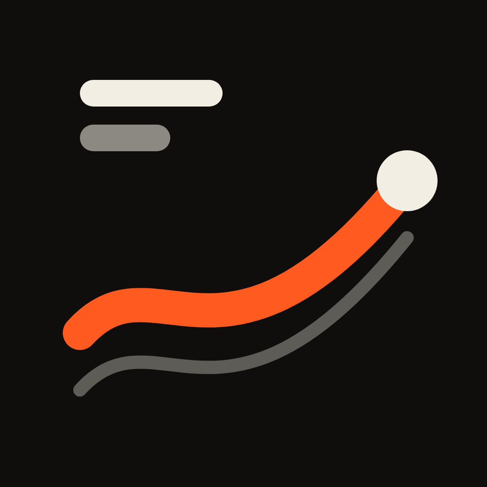

<p align="center">
  
</p>

<h1 align="center">creative-landing</h1>

<p align="center">
  An agent skill that builds animated, award-level landing pages
  instead of the usual template with cards and fades.
</p>

<p align="center">
  <a href="https://github.com/Krowli/creative-landing/releases"></a>
  <a href="LICENSE"></a>
  <a href="https://code.claude.com/docs/en/plugins"></a>
  <a href="https://agentskills.io/specification"></a>
  <a href="https://github.com/Krowli/creative-landing/actions/workflows/validate.yml"></a>
  <a href="https://github.com/Krowli/creative-landing/stargazers"></a>
</p>

---

## What it does

Ask your agent for a landing page ("make a landing for my bakery", "redesign this page,
it looks boring", "make it like this site") and the skill runs the whole job:

- **Asks about the business, not about design.** One message with numbered questions and
  suggested answers. The client never has to pick a font or a "style".
- **Chooses the art direction itself** and explains it in plain words, from the product's
  own world: its material, ritual or data. It does not reach for "tech glow".
- **Requires two showcase scenes** (the hero and one mid-page): 3D, WebGL, scroll-driven
  stories, kinetic type, the client's photos turned into depth.
- **Builds with parallel subagents.** Each owns its own files; the lead agent owns the
  shared ones.
- **Checks everything in a headless browser.** Screenshots at phone and desktop sizes,
  fps under a throttled CPU, an overlap and framing checklist, and a render budget so
  QA doesn't burn tokens.
- **Takes the site to launch:** legal pages, search files, security headers, redirects
  from the old site, and a handover table for the client.

## Install

**Claude Code plugin** (recommended, Claude Code 2.1.275 or later):

```text
/plugin install creative-landing --marketplace Krowli/creative-landing
```

On older versions:

```text
/plugin marketplace add Krowli/creative-landing
/plugin install creative-landing@krowli
```

**As a plain skill** (Claude Code or any agent that reads the
[Agent Skills](https://agentskills.io) format):

```sh
git clone https://github.com/Krowli/creative-landing.git
cp -R creative-landing/skills/creative-landing ~/.claude/skills/
```

**QA scripts** need Google Chrome and `puppeteer-core`:

```sh
cd ~/.claude/skills/creative-landing/scripts && npm install
```

## Use

Just describe the page. The skill triggers on requests such as:

```text
Make a landing page for my handmade candle shop. Photos are in ./photos.
This page looks generic. Redesign it, keep the copy.
Build a site like the one in this video, but for our sleep tracker.
```

## How it works

| Phase | Who | Output |
|---|---|---|
| 0. Interview | lead agent | business answers, client materials |
| 1. Art direction | lead agent | `DIRECTION.md`: core idea, motion character, scenes, palette, type, sections |
| 2. Checkpoint | client | "go", or three static mockups to choose from |
| 3. Scaffold | lead agent | app, tokens and a build-time token check, site chrome, search files |
| 4. Build | subagents in parallel | showcase scenes and sections |
| 5. QA loop | QA subagent, then builders | defect list, fps numbers, fixes |
| 6. Report | lead agent | what was built, lowest fps, what is still weak |
| 7. Revisions | lead agent, then the owning builder | plain-words complaints turned into fixes |
| 8. Launch | lead agent | legal pages, CSP, redirects, deploy verified live, handover |

Selling on the site (basket, payment, delivery) is added only when the client asks for it.

## What's inside

```text
skills/creative-landing/
├── SKILL.md                     entry point: workflow, non-negotiables, red flags
├── references/                  read one at a time, when the phase starts
│   ├── interview.md             questions in plain words, mockups, checkpoint
│   ├── art-direction.md         DIRECTION.md template and scene catalogue
│   ├── build-with-subagents.md  scaffold, site chrome, search files, builder briefs
│   ├── style-architecture.md    token layers and the build-time check
│   ├── toolkit.md               libraries for motion, 3D, video, sound, performance
│   ├── motion-rules.md          rules pasted into every builder brief
│   ├── qa-loop.md               QA brief, render budget, responsive pass
│   ├── revisions.md             "looks cheap", "it lags" → concrete fixes
│   ├── launch.md                legal, security headers, redirects, handover
│   └── shop.md                  basket, checkout, payment, delivery
├── scripts/                     headless Chrome: shoot.mjs, fps.mjs
└── assets/check-tokens.mjs      token check to copy into a project
```

## Configuration

**Studio credit.** By default the footer of a client site carries no credit. To add
yours, put one line in your `CLAUDE.md`:

```text
Studio credit for client sites: «Design & development by Your Studio» linking to https://your.site
```

## Contributing

Issues and pull requests are welcome. Every change to the skill is tested the same way:
run a scenario with subagents on the old version, then on the new one, and keep the
change only if the new version does better and is not worse anywhere.
`claude plugin validate . --strict` must pass.

## License

[MIT](LICENSE)
